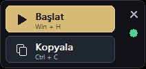
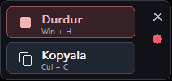

# Hızır Bey · Mini Dikte 0.1.1

212 × 100 piksel mini panel: Başlat/Durdur, Kopyala, X ve kırmızı/yeşil durum noktası. Logo ve görünür metin alanı yoktur. 0.1.1, durdurulan oturumu **kopyaladıktan sonra temizler**; sonraki dikte boş kutuda başlar.

1. Eski mini dikteyi **X** ile tamamen kapatıp `Hizir-Bey-WorkSpaces-Dikte-Mini-0.1.1.exe` dosyasını aç. Ayrı AutoHotkey kurulumu gerekmez.
2. **Başlat / Win+H** ile dikteyi aç. Yedek kısayol **Ctrl+Alt+H**. Windows'un kendi Dinleniyor göstergesini gördükten sonra konuş.
3. **Durdur / ikinci Win+H**, son kelimeleri bekler, temel Türkçe noktalamayı tamamlar, panoya kopyalar ve başarılı kopyadan sonra gizli kutuyu temizler. Genellikle yaklaşık bir saniye sonra uygun alanda **Ctrl+V** kullan.
4. Durdurur durdurmaz Başlat'a basılırsa önce önceki oturumun kopyalanıp temizlenmesi tamamlanır, ardından yeni dikte otomatik açılır. Eski metin yeni oturuma taşınmaz.
5. **Kopyala / Ctrl+C** dinleme sırasında tüm metnin anlık kopyasını alır; dinlemeyi durdurmaz ve devam eden taslağı silmez. Diğer uygulamalardaki Ctrl+C normal çalışır.
6. Kopyalama başarısızsa metin korunur ve bekleyen yeniden başlatma iptal edilir. Kopyala ile tekrar dene veya Başlat'a basarak kopyalamayı yeniden denetlet. Yeni oturum başarısız kopyanın üzerine başlamaz.
7. Boş oturum eski panoyu silmez. Başarıyla kopyalanıp temizlenen metin Ctrl+Z ile geri getirilemez.
8. Dinleme açıkken nokta kırmızı, durdurulduğunda yeşildir. Nokta uygulama durumudur; Windows ses hizmetinin bağımsız duraklamasını veya mikrofon arızasını ölçmez.
9. Sağdaki boş şeritten sürükle; konum hatırlanır. **X**, kendi uygulama sürecini tamamen kapatır. Başka AutoHotkey makroları kapatılmaz.

Otomatik yapıştırma/gönderim, pano köprüsü, API anahtarı, ses kaydı veya taslakların diske yazılması yoktur. Mevcut konum dosyası korunur: `%LOCALAPPDATA%\HizirBey\WorkSpacesDikteMini\panel.ini`. Windows 11 x64, mikrofon ve çalışan yerel Windows sesli yazma gerekir.

## Doğrulama ve derleme

`python scripts/package.py --check` izin listesini ve sabitlenmiş resmi runtime hash'ini denetler. `scripts/build-exe.ps1`, resmi Ahk2Exe ile tek EXE üretir. `tests/windows-tests.ahk`, gerçek native edit ve pano üzerinde uygulama davranışını denetler; yalnız mikrofon başlatma/durdurma çağrıları sayaçlarla değiştirilir. `tests/compiled-tests.ahk` tek EXE'nin yerleşim, pano ve tam kapanmasını denetler. Sonuçlar `TEST-RAPORU.md` dosyasındadır.

Gerçek mikrofon tanıması ve tam ekran WorkSpaces oturumu otomatik test edilmez. Noktalama temel yerel kurallardır; göndermeden önce yapıştırılan metni kontrol et. Lisans GPL-2.0-or-later.
